# Go 全栈微盘交易系统源码

### Gin + Gorm + Vue3 + uni-app | 四端架构 | 撮合交易引擎 | 多级代理分润

一套完整的 Go 全栈微盘交易平台源码，采用前后端分离架构，一个 Go 后端统一驱动四个独立前端。

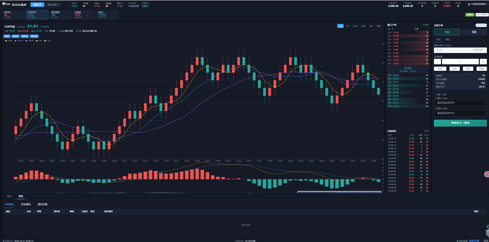

**系统包含：**
- 总管理后台：用户管理、权限管理、交易管理、资金管理、行情运营。
- 代理商后台：客户管理、额度划拨、多级代理、手续费及分润结算。
- PC 用户交易端：实时行情、K 线图、买涨买跌、订单及持仓管理。
- 移动端用户交易端：基于 uni-app，支持 H5、App、微信小程序。

**核心业务功能：**
- B-Book 撮合交易引擎
- 实时行情生成与 WebSocket 推送
- 市价单、限价单及订单撮合
- 止盈止损、保证金计算与自动强平
- 多级代理分润与日终结算
- 充值提现与资金流水管理
- RBAC 角色权限管理
- 多端 API 统一管理

**技术栈：** Go、Gin、Gorm、MySQL、Redis、JWT、WebSocket、Vue3、TypeScript、Element Plus、ECharts、uni-app。

**联系方式：** Telegram（飞机）[@cgydgzs](https://t.me/cgydgzs)

本项目为商业软件源码，适用于授权范围内的二次开发、测试及合规部署。行情控制及 B-Book 机制属于平台运营控制功能，并非真实交易所行情或独立撮合市场。实际商业运营前须自行评估适用法律、金融监管及合规要求。

**技术栈**：Go · Gin · Gorm · MySQL · Redis · JWT · WebSocket | Vue3 · Vite · Element Plus · Pinia · ECharts | uni-app（H5/App/小程序）

**搜索关键词**：`go 管理框架`、`gin gorm vue 后台`、`rbac 权限系统`、`微盘交易系统`、`撮合引擎`、`期货微盘源码`、`做市商 bbook`、`代理分润系统`、`多端全栈`、`websocket 实时行情`

## 目录

- [功能一览](#功能一览)
- [演示图片](#演示图片)
- [核心交易引擎](#核心交易引擎)
- [技术亮点](#技术亮点)
- [项目结构](#项目结构)
- [快速启动](#快速启动)
- [默认账号](#默认账号)
- [内置文档](#内置文档)
- [联系方式](#联系方式)
- [License](#license)

---

## 功能一览

### 总管理后台（`ease-ui`，TypeScript + Element Plus）

| 模块 | 功能明细 |
| --- | --- |
| **系统管理** | 管理员增删改查 / 启用禁用；角色管理（可设超级角色）；菜单权限树（目录-菜单-按钮三级，支持排序）；角色-菜单批量授权；操作日志审计（按模块/耗时/状态筛选，支持单条删除与一键清空）；系统设置（网站信息 / OSS 存储 / 邮箱 / 短信分组管理，邮箱连通性自测） |
| **交易品种管理** | 品种增删改查 / 启用禁用；每品种独立配置：杠杆倍数（默认 10）、保证金率、合约乘数、最小变动单位（TickSize）、每手固定手续费、按成交额费率；品种交易时段与 24 小时模式开关 |
| **订单 / 持仓查询** | 全平台订单列表（按用户 / 品种 / 状态 / 时间筛选，支持穿透任意代理名下客户）；当前持仓列表（全平台未平仓仓位、实时浮动盈亏、风险率） |
| **出入金管理** | 充值申请审核（确认后到账）、提现申请审核（线下打款后核销）；手动资金调整（给用户加款 / 扣款，操作留痕）；资金流水总表（充值 / 提现 / 手续费 / 盈亏 / 强平全类型） |
| **用户管理** | C 端用户列表（按代理归属筛选）；用户详情（持仓 / 资金 / 交易记录）；用户启用 / 禁用；实名认证信息审核；强制平仓干预 |
| **代理商管理** | 代理商创建 / 启用禁用（可指定上级形成层级关系）；额度划拨；手续费分润比例、客损分润比例逐项配置；代理分润提现审核；推广链接前缀统一配置 |
| **收款地址管理** | 银行 / 加密货币收款地址的增删改查、重置、启停（供用户端出入金展示） |
| **行情运营台** | 引擎模式切换：随机震荡 / 人工定向引导 / 暂停行情；交易时段设置（开市 / 收盘时间，支持 24 小时模式）；目标价引导（SetPrice 平滑收敛，可指定周期）；插针干预（指定秒数瞬间拉高 / 砸低价格）；虚拟盘口注入（手动注入假挂单，跨重启保留）；系统强平线配置；全部控盘操作留痕（`/trade/control` 日志可查可回放） |
| **公告 / 轮播** | 站内公告发布 / 撤回（用户端与 App 同步收到）；App 首页 Banner 轮播管理 |
| **数据看板** | 平台总用户数、总交易量、今日盈亏、手续费收入、实时行情快照（各品种当前价 / 涨跌幅） |
| **内置业务组件库** | 基于 Ease UI：表格 / 搜索表单 / 图表 / 甘特图 / 流程图设计器 / 中国地图 / 条码 / 二维码 / 图片裁剪 / 文件预览（docx、excel、pdf、ppt）等 20+ 开箱即用 |

### 代理后台（`agent-ui`）

- **数据看板**：我的可用额度、名下客户总数、今日活跃、今日总交易量、今日预估分润收益
- **客户管理**：直属客户列表（余额 / 持仓 / 累计贡献手续费）；为客户上分 / 下分（扣减自身额度，备注留痕）
- **下级代理**：创建下级代理并划拨额度，查看下级业绩
- **分润明细**：按日 / 周 / 月查看各动作分润（手续费分润、客损分润、级差结算）；分润钱包余额
- **推广物料**：专属邀请码、带参推广链接、二维码（客户扫码注册自动绑定到该代理名下）
- **提现**：分润提现申请、提现记录查询；收款信息（银行卡 / USDT 地址）维护

### PC 用户端（`client-pc-ui`）

- **账户**：注册（需填写代理邀请码自动绑定归属关系）/ 登录 / 找回密码（短信或邮箱验证码）；修改登录密码、设置独立资金密码；实名认证信息提交；个人资料（头像 / 昵称）
- **行情中心**：多品种切换条；实时 K 线（ECharts，秒级 Tick 驱动，最后一根 K 线动态伸缩，整分钟准时定格）；五档盘口（真实挂单 + 虚拟注入混合展示）；最新价 / 涨跌幅 / 开高低 / 成交量额；分时成交明细（实时滚动）
- **交易下单**：买涨（开多）/ 买跌（开空）；市价单 / 限价单；手数快捷按钮（±）与自定义；担保金 / 手续费实时估算（下单前可见）；撤单；止盈止损价位预设，成交后系统实时监控触发自动平仓；当前委托 / 历史订单 / 成交流水查询
- **持仓管理**：实时持仓列表（建仓价 / 现价 / 浮动盈亏 / 占用担保金 / 风险率）；风险率低于阈值红色预警；单笔平仓 / 一键全平
- **资金账户**：充值申请（展示平台收款地址）、提现申请（后台审核后到账）；资产总览（实时资产 / 可用余额 / 占用担保金 / 浮动盈亏）；资金流水明细（充值 / 提现 / 手续费 / 盈亏 / 强平）
- **其他**：系统通知（公告 / 强平预警 / 出入金审核结果推送，未读角标）；联系所属代理（微信 / 联系方式卡片）；市场开休市状态实时显示

### 移动端用户端（`uniapp`）

基于 uni-app 开发，一套代码可打包 H5 / App（iOS / Android）/ 微信小程序，功能与 PC 端对齐：

- **首页**：轮播 Banner（后台配置）、品种卡片（实时价格 / 涨跌幅）、交易状态
- **交易页**：K 线图、盘口、下单面板（买涨 / 买跌 / 市价 / 限价 / 止盈止损）、当前持仓与浮动盈亏、一键平仓
- **资金页**：充值 / 提现 / 历史记录 / 流水明细
- **我的**：登录 / 注册 / 忘记密码；个人信息 / 实名认证 / 安全设置（资金密码）；所属代理信息；系统通知
- **适配**：移动端手势与响应式布局，弱网断线自动重连（WS 重连后拉取当前分钟开 / 高 / 低 / 最新价补齐 K 线）

### 后端 API（`server`，单端口三端）

- **管理端** `/api/*`：JWT（admin token）+ RBAC 权限中间件（`Perm("sys:xxx")` 接口级控权，超级角色全放行）+ 操作日志全局审计
- **C 端用户** `/api/user/*`：JWT（user token）；`/api/trader/*` 为 Web 交易兼容层（`x-token` 头，`code=0` 成功协议）
- **代理端** `/api/agent/*`：JWT（agent token）
- **公开行情** `/api/market/*`：品种列表 / K 线 / 预测 K / 盘口 / 交易时间（无需登录，供展示与爬虫）
- **WebSocket**：`/ws`（私有推送：成交回报 / 强平通知 / 公告）与 `/ws/market`（公共行情：tick / kline / depth / trades 广播），订阅 / 取消订阅按品种分桶广播，慢连接自动丢弃防止阻塞主流程
- **内置访问有效期控制中间件**（`middleware/access.go`）：到期时间硬编码于源码，跨期后自动拦截业务请求（健康检查与 WS 握手保留），用于商业授权期限管控，可按需移除


---

## 演示图片

> 以下截图均来自实际运行环境，覆盖四端核心业务流程。点击图片可查看原图。

### 总管理后台（ease-ui）

<table>
  <tr>
    <td width="50%" align="center"><a href="screenshots/admin/01-dashboard.png">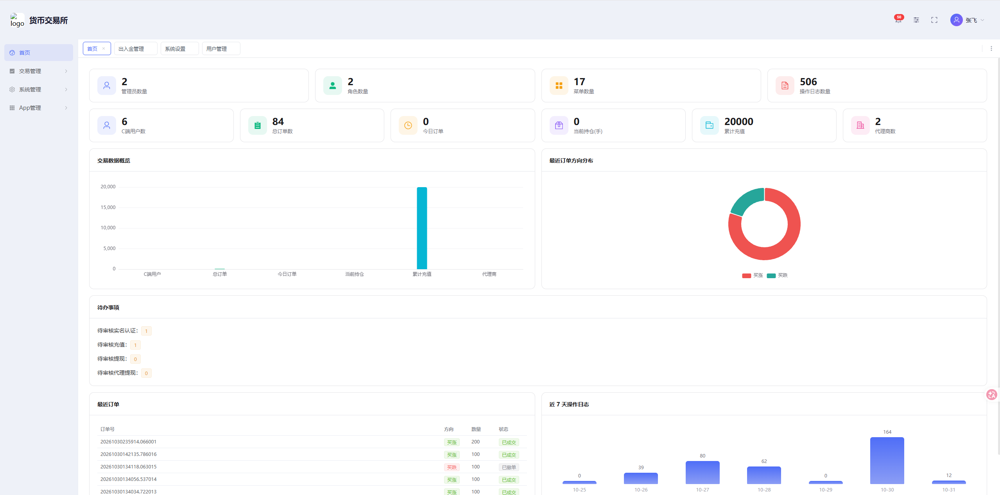</a><br><sub>数据看板：平台核心指标、待办审核、最近订单与操作日志</sub></td>
    <td width="50%" align="center"><a href="screenshots/admin/02-products.png">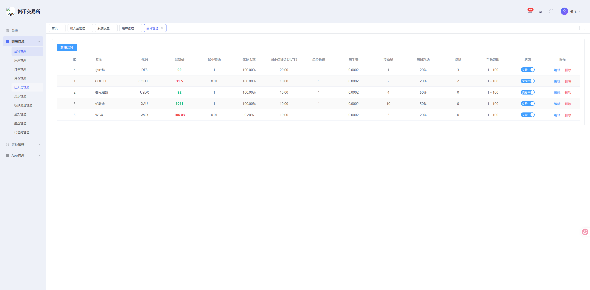</a><br><sub>品种管理：最小变动、保证金率、固定保证金、每手费、浮动量、手数范围</sub></td>
  </tr>
  <tr>
    <td width="50%" align="center"><a href="screenshots/admin/03-users.png">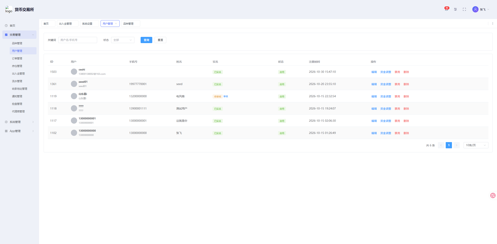</a><br><sub>用户管理：实名状态、启用禁用、资金调整与删除</sub></td>
    <td width="50%" align="center"><a href="screenshots/admin/04-orders.png">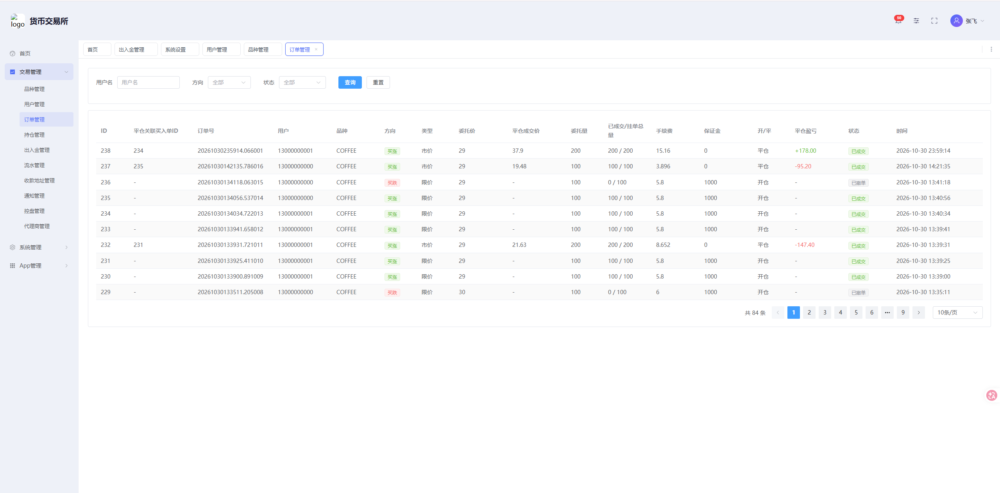</a><br><sub>订单管理：全平台委托与成交、手续费、保证金、平仓盈亏</sub></td>
  </tr>
  <tr>
    <td width="50%" align="center"><a href="screenshots/admin/05-positions.png">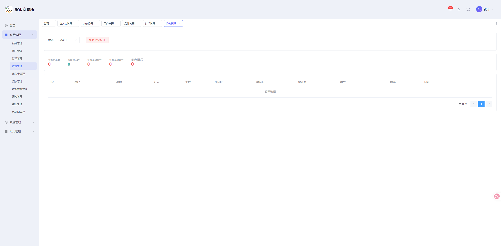</a><br><sub>持仓管理：多空手数与浮动盈亏汇总、一键强制平仓</sub></td>
    <td width="50%" align="center"><a href="screenshots/admin/06-funds-review.png">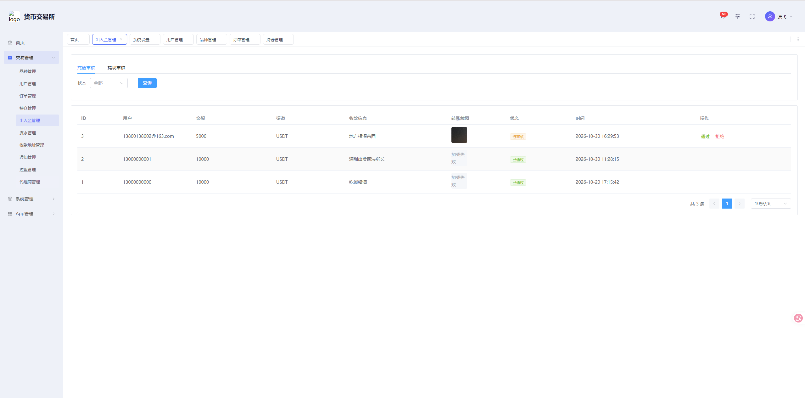</a><br><sub>出入金管理：充值 / 提现审核、转账凭证查看</sub></td>
  </tr>
  <tr>
    <td width="50%" align="center"><a href="screenshots/admin/07-fund-flow.png">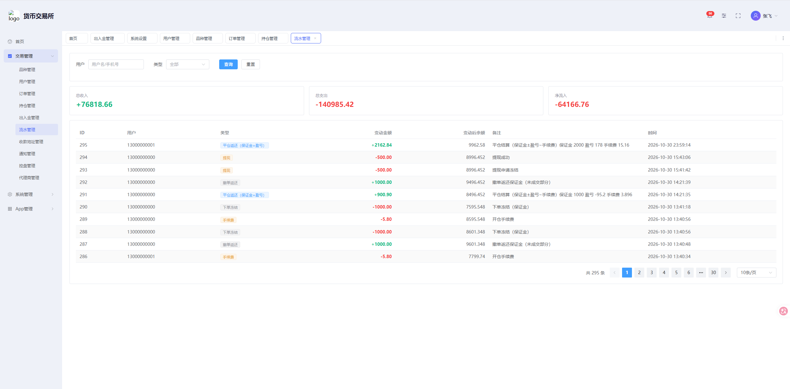</a><br><sub>流水管理：全类型资金变动明细与收支 / 净流入汇总</sub></td>
    <td width="50%" align="center"><a href="screenshots/admin/08-payment-addresses.png">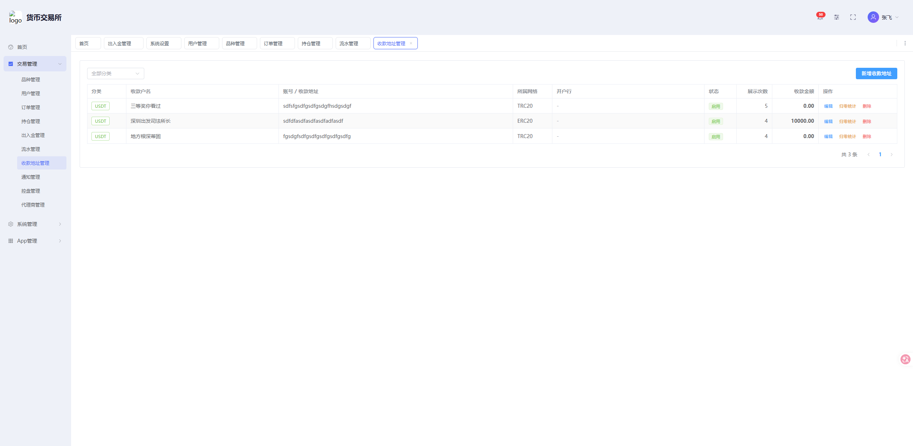</a><br><sub>收款地址管理：USDT / 银行卡地址、所属网络、启停与归零统计</sub></td>
  </tr>
  <tr>
    <td width="50%" align="center"><a href="screenshots/admin/09-notifications.png">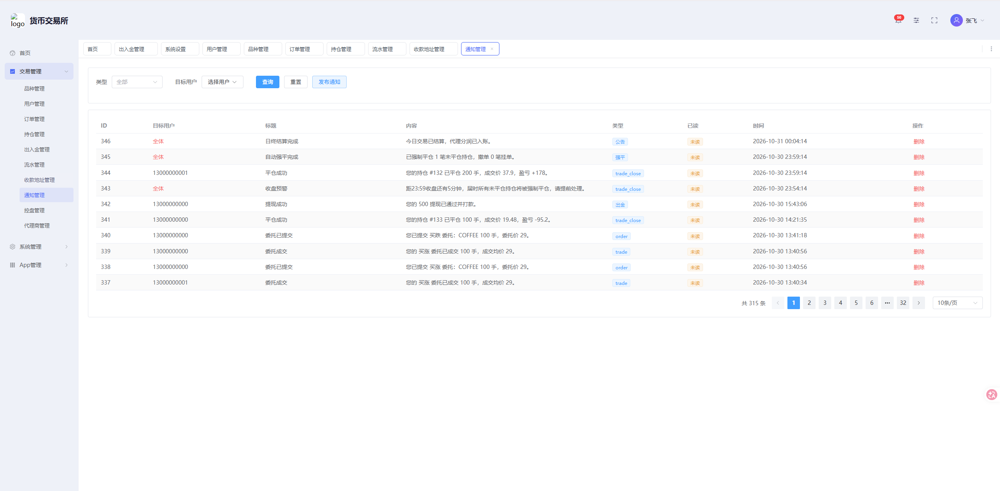</a><br><sub>通知管理：站内公告与交易、风控、出入金消息推送记录</sub></td>
    <td width="50%" align="center"><a href="screenshots/admin/10-market-control.png">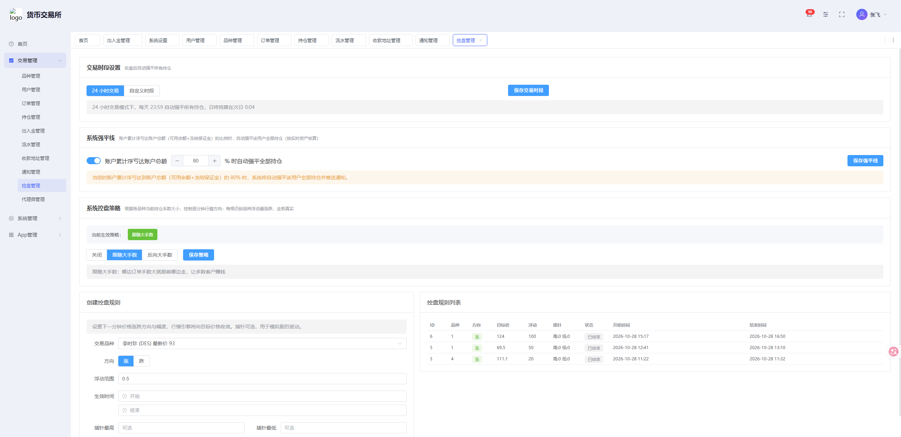</a><br><sub>控盘管理：交易时段、系统强平线、控盘策略与目标价 / 插针规则</sub></td>
  </tr>
  <tr>
    <td width="50%" align="center"><a href="screenshots/admin/11-agents.png">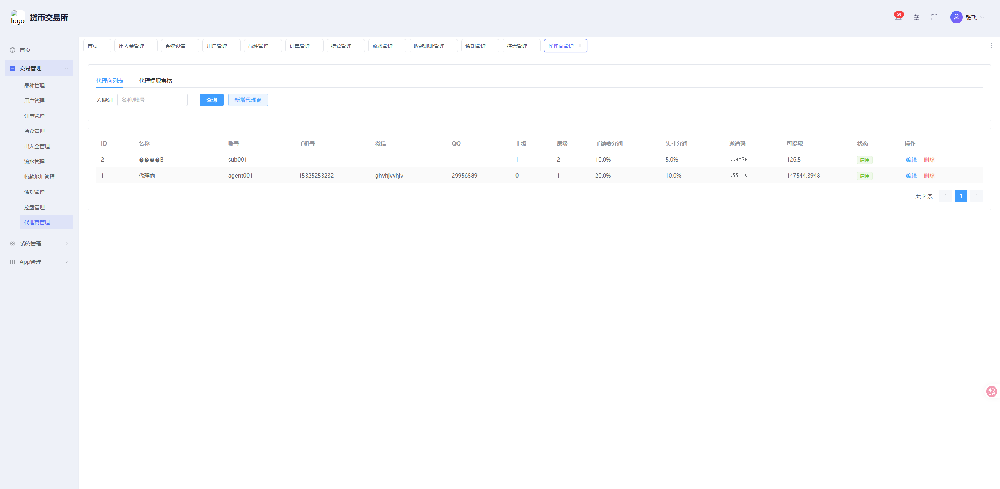</a><br><sub>代理商管理：多级代理、手续费 / 头寸分润比例、邀请码、可提现余额</sub></td>
    <td width="50%" align="center"><a href="screenshots/admin/12-settings.png">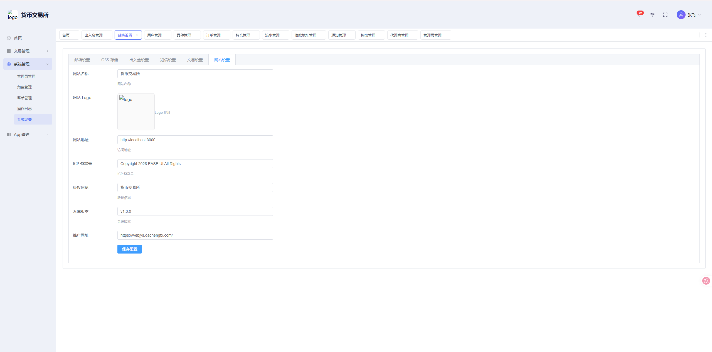</a><br><sub>系统设置：网站信息、OSS 存储、邮件、短信、交易与客服配置</sub></td>
  </tr>
  <tr>
    <td width="50%" align="center"><a href="screenshots/admin/13-banners.png">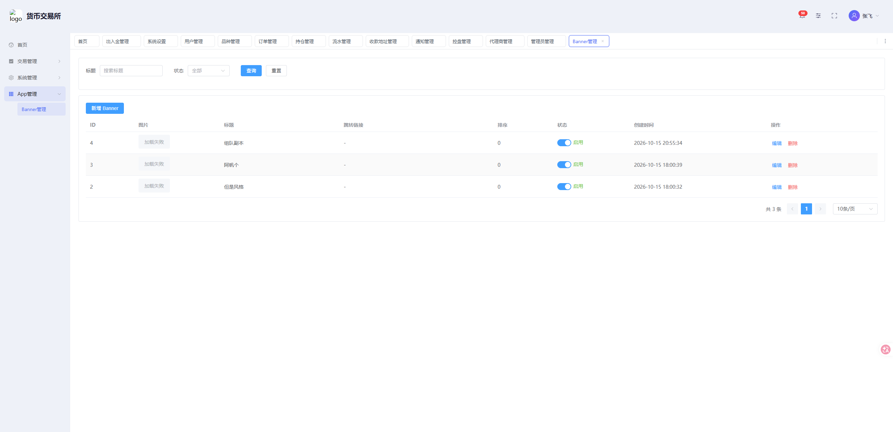</a><br><sub>Banner 管理：App 首页轮播图、跳转链接与排序</sub></td>
    <td width="50%"></td>
  </tr>
</table>

### 代理后台（agent-ui）

<table>
  <tr>
    <td width="50%" align="center"><a href="screenshots/agent/01-dashboard.png">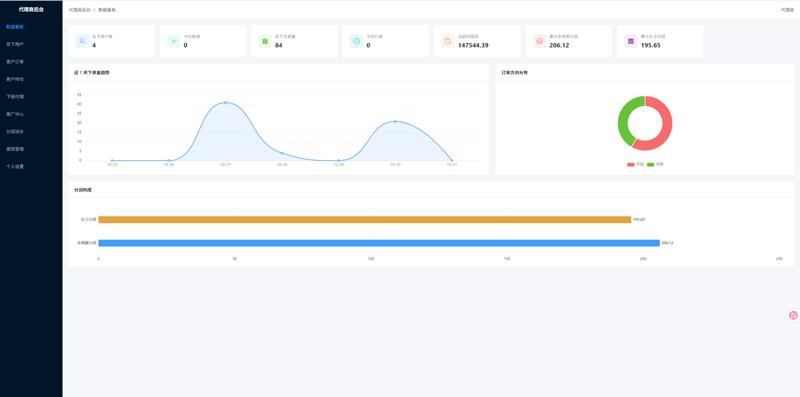</a><br><sub>数据看板：名下用户、交易量、可提现分润、近 7 天订单趋势</sub></td>
    <td width="50%" align="center"><a href="screenshots/agent/02-customers.png">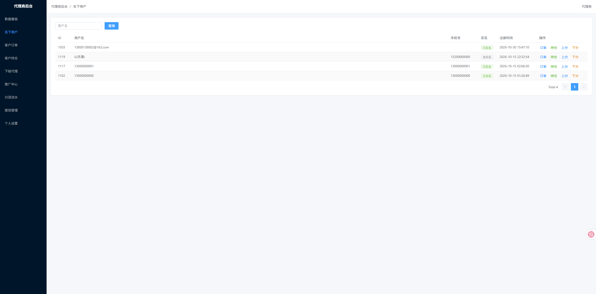</a><br><sub>名下用户：客户列表、实名状态、上分 / 下分与订单持仓入口</sub></td>
  </tr>
  <tr>
    <td width="50%" align="center"><a href="screenshots/agent/03-customer-orders.png">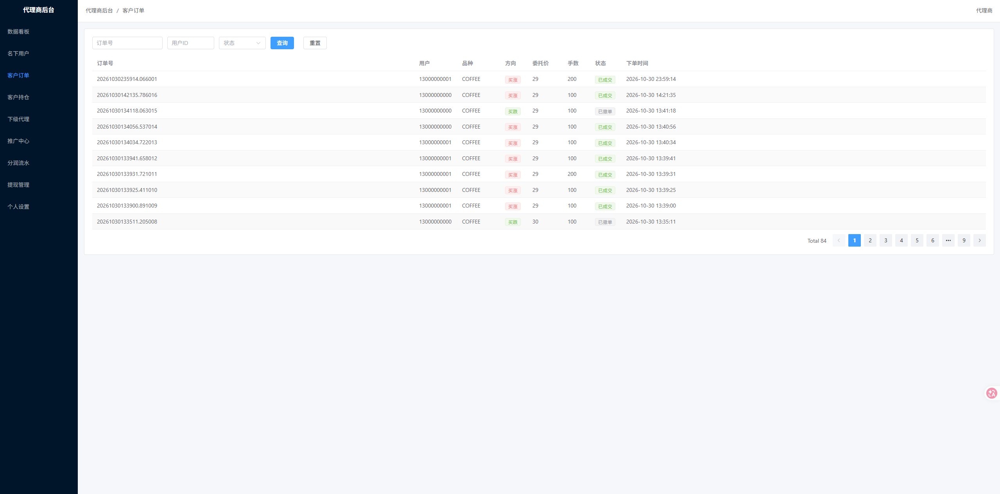</a><br><sub>客户订单：按订单号 / 用户 / 状态筛选名下客户委托</sub></td>
    <td width="50%" align="center"><a href="screenshots/agent/04-customer-positions.png">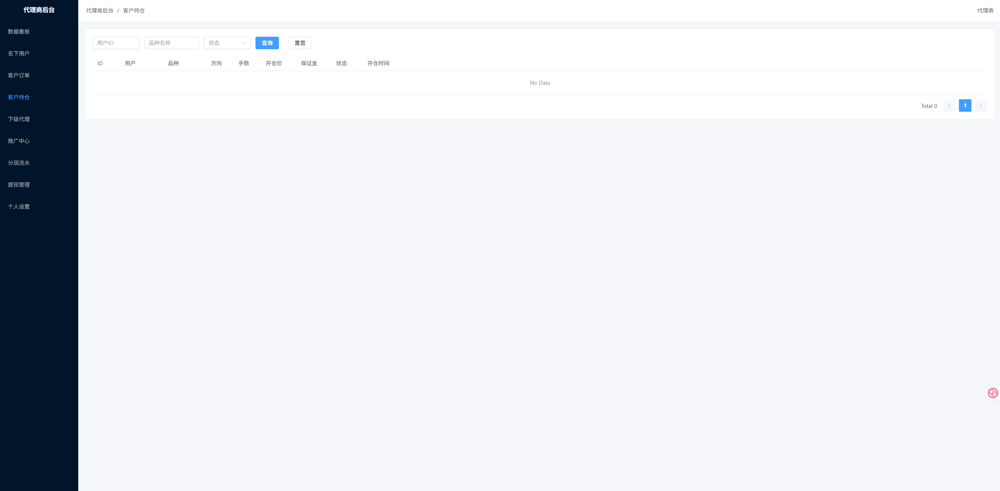</a><br><sub>客户持仓：持仓方向、手数、开仓价、保证金</sub></td>
  </tr>
  <tr>
    <td width="50%" align="center"><a href="screenshots/agent/05-sub-agents.png">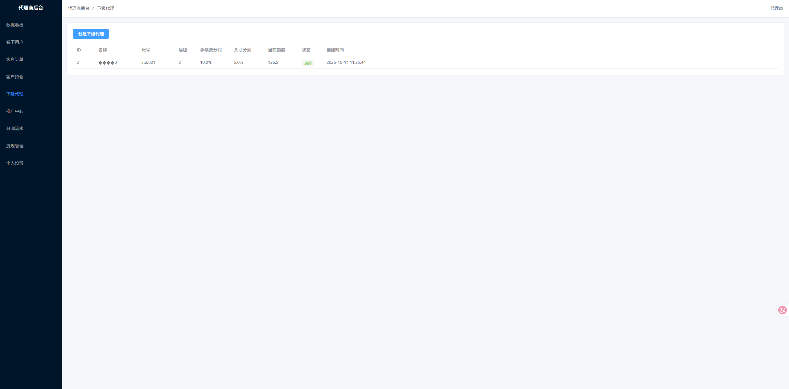</a><br><sub>下级代理：创建下级、层级、分润比例与当前额度</sub></td>
    <td width="50%" align="center"><a href="screenshots/agent/06-promotion.png">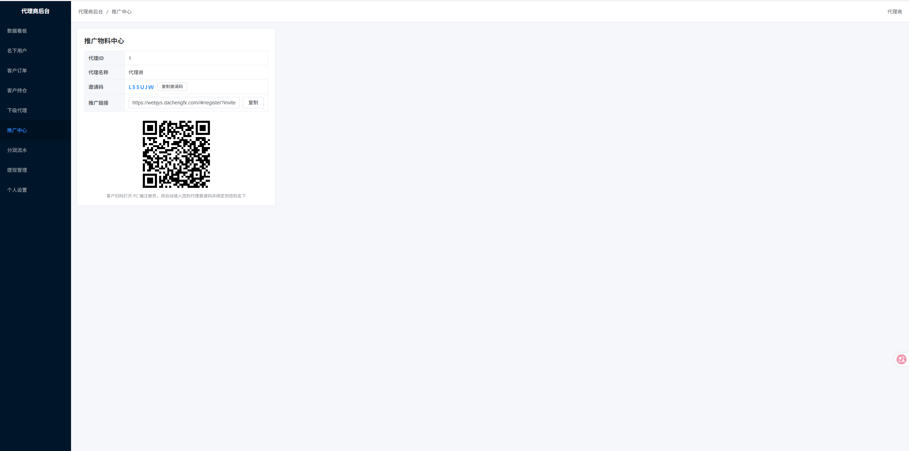</a><br><sub>推广中心：专属邀请码、带参推广链接与注册二维码</sub></td>
  </tr>
  <tr>
    <td width="50%" align="center"><a href="screenshots/agent/07-commission-flow.png">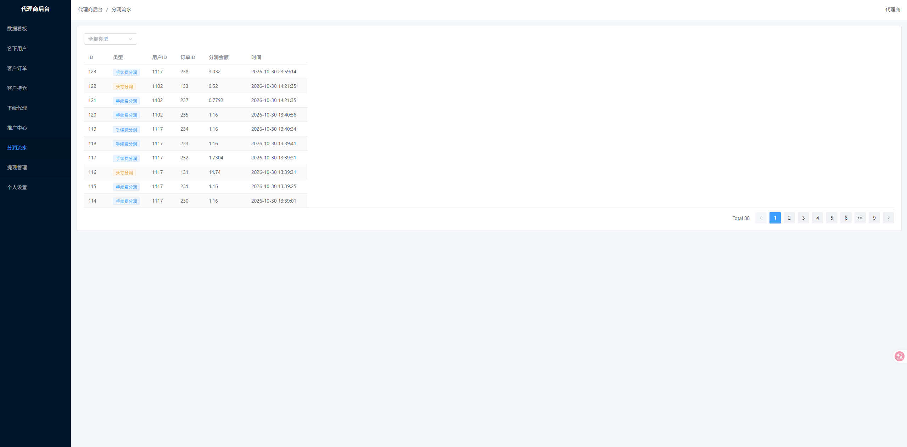</a><br><sub>分润流水：手续费分润、头寸分润逐笔明细</sub></td>
    <td width="50%" align="center"><a href="screenshots/agent/08-withdrawals.png">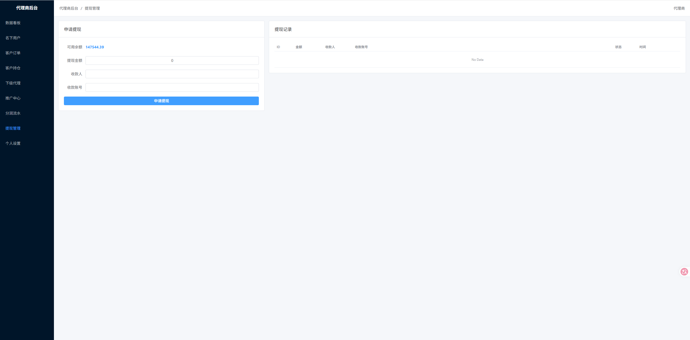</a><br><sub>提现管理：分润余额提现申请与提现记录</sub></td>
  </tr>
  <tr>
    <td width="50%" align="center"><a href="screenshots/agent/09-settings.png">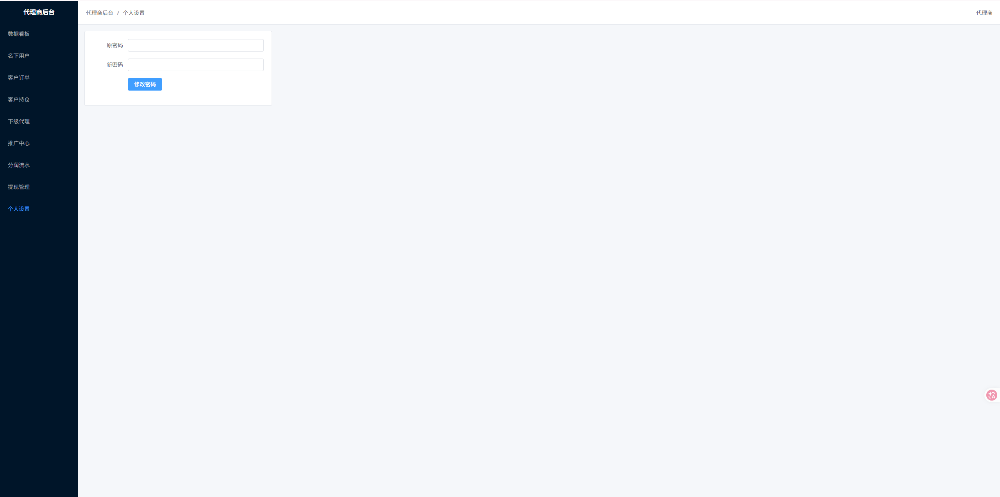</a><br><sub>个人设置：代理后台登录密码修改</sub></td>
    <td width="50%"></td>
  </tr>
</table>

### PC 用户交易端（client-pc-ui）


<sub>交易大厅：多品种行情、K 线与技术指标、五档盘口、下单面板、持仓 / 委托 / 成交</sub>

<table>
  <tr>
    <td width="50%" align="center"><a href="screenshots/pc/02-funds.png">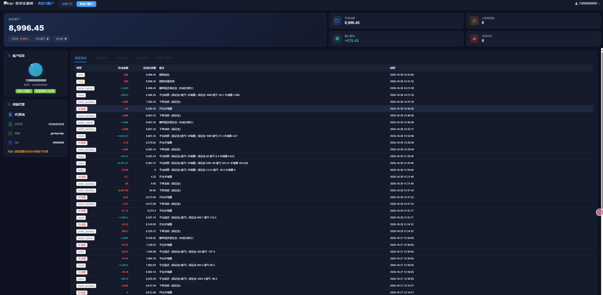</a><br><sub>资金与账户：资产总览、资金流水、充值 / 提现 / 安全设置 / 联系代理</sub></td>
    <td width="50%" align="center"><a href="screenshots/pc/03-login.png">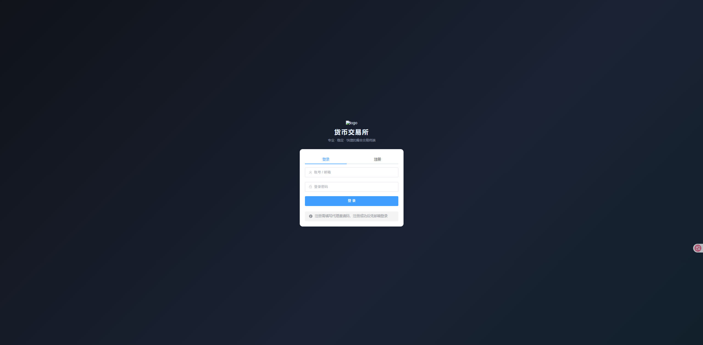</a><br><sub>登录 / 注册：账号或邮箱登录，支持代理邀请码注册</sub></td>
  </tr>
</table>

### 移动端用户端（uniapp）

<table>
  <tr>
    <td width="25%" align="center"><a href="screenshots/h5/01-login.png">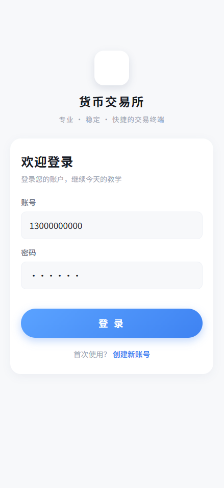</a><br><sub>登录</sub></td>
    <td width="25%" align="center"><a href="screenshots/h5/02-register.png">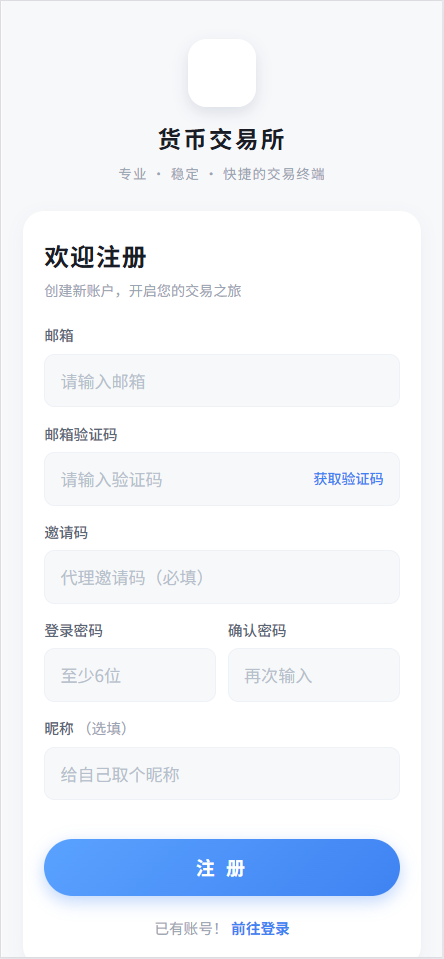</a><br><sub>注册：邮箱验证码 + 代理邀请码</sub></td>
    <td width="25%" align="center"><a href="screenshots/h5/03-home.png">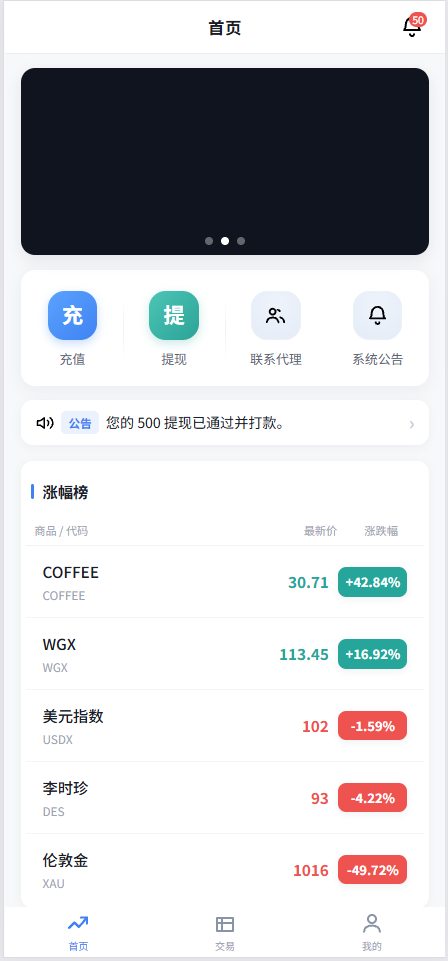</a><br><sub>首页：轮播、快捷入口、公告、涨跌榜</sub></td>
    <td width="25%" align="center"><a href="screenshots/h5/04-market-detail.png">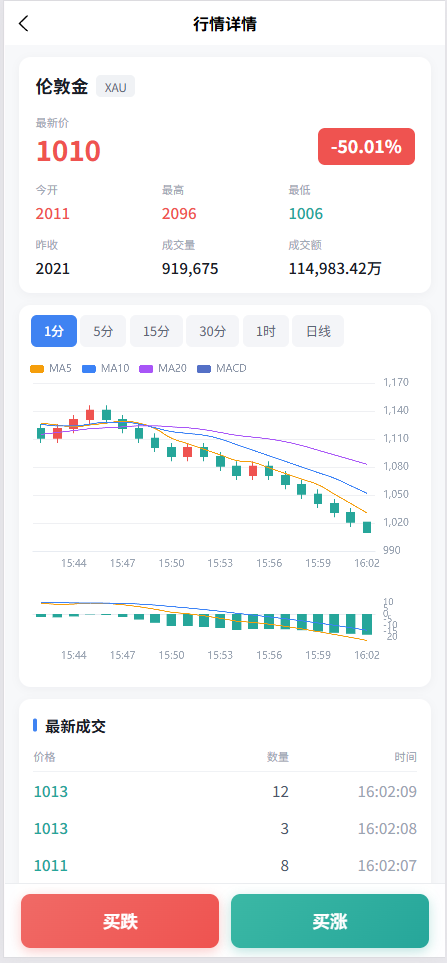</a><br><sub>行情详情：K 线、分时、最新成交</sub></td>
  </tr>
  <tr>
    <td width="25%" align="center"><a href="screenshots/h5/05-trade.png">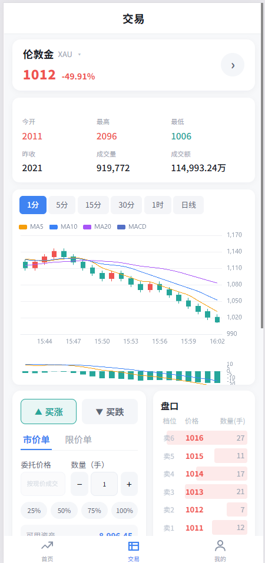</a><br><sub>交易页：行情、K 线、盘口</sub></td>
    <td width="25%" align="center"><a href="screenshots/h5/06-trade-order.png">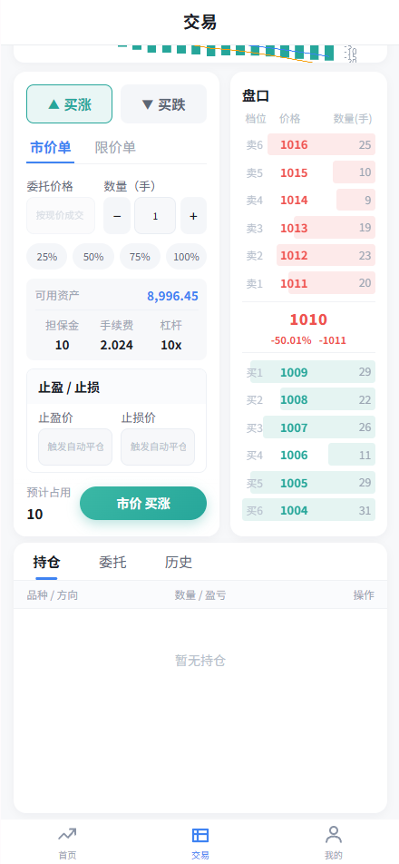</a><br><sub>下单面板：市价 / 限价、止盈止损、持仓 / 委托 / 历史</sub></td>
    <td width="25%" align="center"><a href="screenshots/h5/07-profile.png">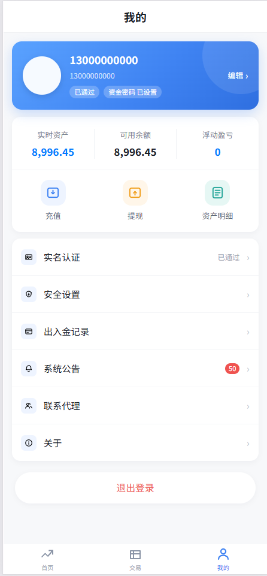</a><br><sub>我的：资产总览、实名 / 安全、公告、联系代理</sub></td>
    <td width="25%" align="center"><a href="screenshots/h5/08-account-info.png">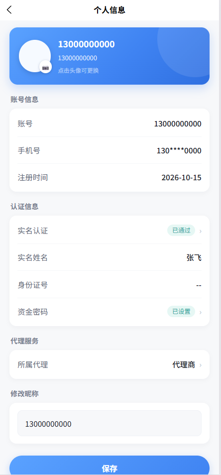</a><br><sub>个人信息：账号、实名、资金密码、所属代理</sub></td>
  </tr>
  <tr>
    <td width="25%" align="center"><a href="screenshots/h5/09-deposit.png">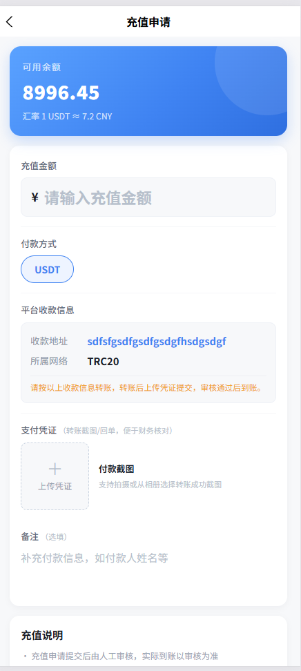</a><br><sub>充值申请：USDT 收款地址、转账凭证上传</sub></td>
    <td width="25%" align="center"><a href="screenshots/h5/10-withdraw.png">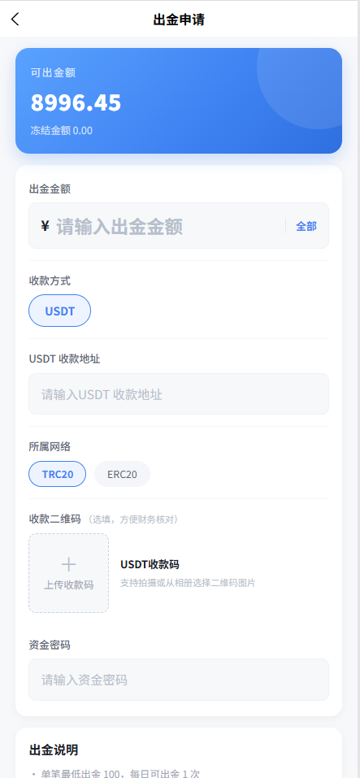</a><br><sub>出金申请：USDT / 银行卡、资金密码校验</sub></td>
    <td width="25%" align="center"><a href="screenshots/h5/11-security.png">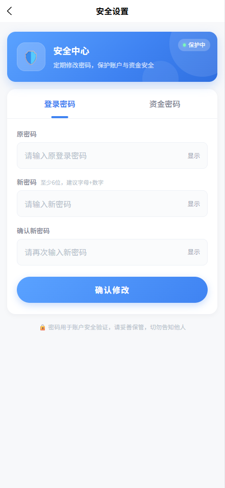</a><br><sub>安全设置：登录密码 / 资金密码修改</sub></td>
    <td width="25%" align="center"><a href="screenshots/h5/12-fund-records.png">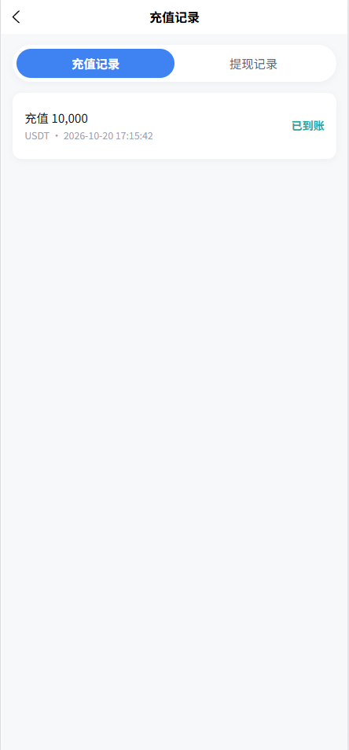</a><br><sub>出入金记录：充值 / 提现记录查询</sub></td>
  </tr>
  <tr>
    <td width="25%" align="center"><a href="screenshots/h5/13-notifications.png">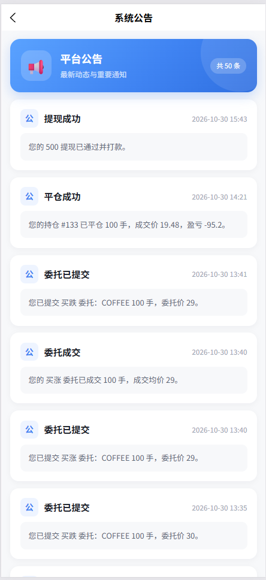</a><br><sub>系统公告：成交、平仓、提现等消息</sub></td>
    <td width="25%" align="center"><a href="screenshots/h5/14-contact-agent.png">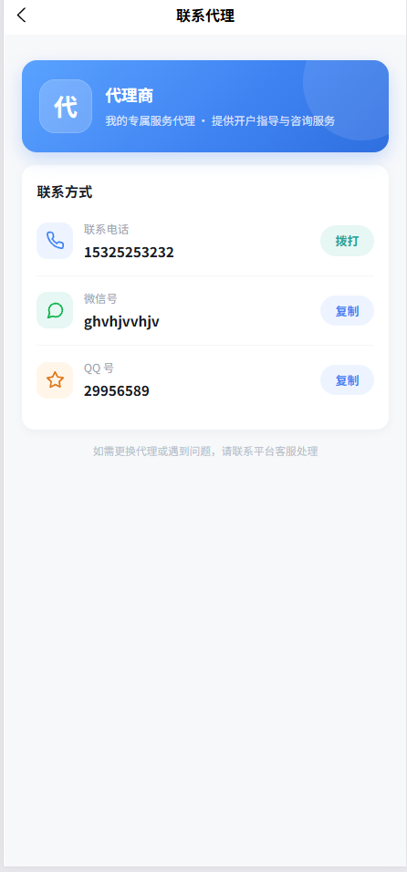</a><br><sub>联系代理：电话、微信、QQ</sub></td>
    <td width="25%"></td>
    <td width="25%"></td>
  </tr>
</table>


---

## 核心交易引擎

后端按「行情引擎 / 撮合引擎 / 风控 / 定时结算」四个子系统组织，全部内存级实时计算，MySQL 做最终落盘：

- **行情引擎**（`services/market`）：秒级 Tick 生成（随机游走 + 目标收敛算法，每分钟准时定格），支持人工定向引导（SetPrice 平滑收敛）、大单冲击（插针）、行情冻结；交易时段（开市/休市/24小时模式）可配；控盘操作全程留痕审计。
- **撮合引擎**（`services/trader`）：B-Book 模式，按产品当前价承接，买涨=开多 / 买跌=开空；市价单立即成交，限价单挂簿等价格触发；支持部分成交、撤单；撮合事件驱动成交回报推送。
- **资金与风控**：金融级金额精度（`shopspring/decimal` 全程，禁用 float）；下单幂等键（`clientOrderId` 唯一索引 + 用户锁双重防重）；保证金计算（价格×合约乘数×手数×保证金率÷杠杆）；风险率实时计算（低于阈值自动强平）；止盈止损条件单毫秒级扫描触发。
- **定时任务**（`services/scheduler`）：21:00 全局不过夜强平（批量平仓、盈亏结算、释放担保金），21:05 日终结算（用户盈亏、手续费、分润批跑）；Redis 分布式锁防止多实例重复执行。
- **实时推送**（`services/mktws` + `push`）：WebSocket 长连接推送行情 Tick、成交回报、强平通知、公告消息，Ping/Pong 心跳与自动清理死连接。
- **分润结算**：订单开仓/平仓/亏损头寸三类动作沿代理链逐级分润，`代理ID + 幂等键` 串行锁 + 数据库唯一索引双重防重，杜绝并发重复分润。

---

## 技术亮点

- **金额精度**：全链路 `shopspring/decimal`，价格/手续费/盈亏/分润均无浮点误差
- **并发安全**：撮合单协程、资金操作分布式锁（Redis），分润幂等键三重防重（进程锁 + 先查后写 + 唯一索引）
- **配置集中**：`config.yaml` 一键改数据库/端口/CORS/上传目录，环境变量可覆盖，缺省值保证裸机直接启动
- **统一 API 规范**：`{code, message, data}` 标准响应，`/api` 版本前缀，操作日志中间件全局审计
- **前端工程化**：总后台 TypeScript + Vite + Element Plus + Pinia（内置 20+ 复用业务组件）；交易端 K 线基于 ECharts 逐秒渲染

---

## 项目结构

```
├── server/          Go 后端（Gin + GORM + MySQL + Redis），单端口三端 API
├── ease-ui/         总管理后台（Vue3 + TS + Element Plus）
├── agent-ui/        代理后台（Vue3 + Element Plus）
├── client-pc-ui/    PC 用户交易端（Vue3 + ECharts K线）
├── uniapp/          移动端用户交易端（uni-app，可打包 H5/App）
├── screenshots/     四端界面截图（admin / agent / pc / h5）
├── 撮合交易规则.md     撮合模型说明（B-Book 系统承接）
├── 保证金与强平公式.md   保证金/手续费/盈亏/强平计算公式
├── 交易资金计算公式.md   资金计算规则
├── 下单幂等机制.md       clientOrderId 防重机制
├── 后端访问有效期控制说明.md
├── 百万量级压测与部署文档.md
└── README.md
```

---

## 快速启动

### 1. 后端

```bash
cd server
# 修改 config.yaml（数据库连接、端口、JWT 密钥等），或使用环境变量覆盖
go run .
# 监听 http://localhost:8080
```

首次启动自动建表（GORM AutoMigrate）并写入种子数据（超级管理员/角色/菜单树）。

### 2. 总管理后台（ease-ui）

```bash
cd ease-ui
pnpm install
pnpm dev
```

### 3. 代理后台（agent-ui）

```bash
cd agent-ui
pnpm install
pnpm dev
```

### 4. PC 用户端（client-pc-ui）

```bash
cd client-pc-ui
pnpm install
pnpm dev
```

### 5. 移动端（uniapp）

使用 HBuilderX 打开 `uniapp/` 目录运行，或 `npm install` 后用 CLI 启动（H5 / 微信小程序 / App）。

### 环境要求

- Go 1.22+、MySQL 5.7+、Redis（可选，未配置时自动降级为纯内存）
- Node 18+、pnpm（前端）

### 部署

参考根目录 `宝塔部署文档.md`（宝塔面板 + Nginx + Go 二进制）与 `server/百万量级压测与部署文档.md`（高并发调优）。

---

## 默认账号

| 端 | 账号 | 密码 |
| --- | --- | --- |
| 总管理后台 | admin | 123456 |

> ⚠️ 上线前务必修改 `config.yaml` 中的 JWT 密钥与数据库口令，并重置默认管理员密码。

---

## 内置文档

| 文档 | 说明 |
| --- | --- |
| `server/API.md` | 全量 API 接口文档（三端分章 + WebSocket 协议 + 内置权限标识） |
| `撮合交易规则.md` | 撮合模型、订单状态机、成交回报规则 |
| `保证金与强平公式.md` | 保证金/手续费/盈亏/强平计算公式 |
| `下单幂等机制.md` | clientOrderId 防重实现说明 |
| `后端访问有效期控制说明.md` | 访问有效期控制中间件（可按需移除） |
| `宝塔部署文档.md` | 宝塔面板部署指南 |
| `百万量级压测与部署文档.md` | 高并发压测与部署建议 |

---

## 联系方式

- Telegram（飞机）：[@cgydgzs](https://t.me/cgydgzs)

---

## License

Copyright © 2025-2026。本项目为商业化源码，购买后获得使用与修改授权；**禁止**二次分发、转售或用于公开 SaaS。
